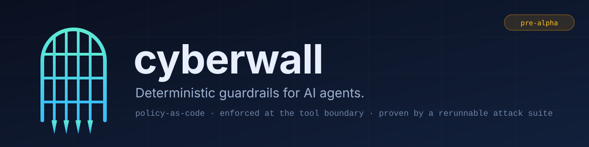
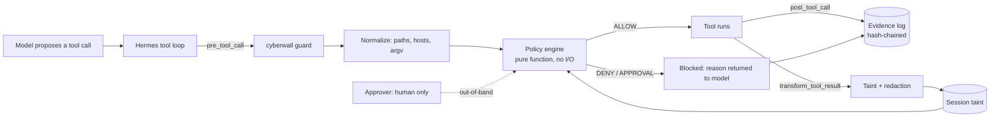

<p align="center">
  
</p>

<p align="center">
  <b>Deterministic policy evaluation for AI agent tool requests.</b><br>
  A local-first security project in early development.
</p>

<p align="center">
  <a href="https://github.com/omermindivanli/cyberwall/actions"></a>
  
  
  
  
</p>

> [!WARNING]
> **Early development, not a production security boundary.** Cyberwall currently evaluates standalone requests and records local evidence. It does not intercept Hermes or any other agent runtime. The integration spike found unresolved Hermes hook contract and argument-mutation risks; see [`docs/hermes-contract.md`](docs/hermes-contract.md). Do not rely on this package to protect a system.

---

## The problem

Agents can propose high-impact tool actions. This project explores deterministic policy evaluation outside the model's reasoning, with a pure core that can be tested independently from an eventual runtime adapter.

## Available in this checkout

| | Capability | What it means |
|---|---|---|
| 🛡️ | **Policy evaluator** | Local `cyberwall eval` checks one tool request against a deterministic policy. Default deny; unknown tools are denied unless explicitly allowed. |
| 🧹 | **Policy lint** | `cyberwall policy lint` reports structurally broad allows and selector conflicts. |
| 🧾 | **Evidence store** | SQLite WAL evidence with a hash chain, redacted path/host fingerprints, `cyberwall evidence verify`, and Markdown/JSON reports. |
| 🧰 | **Policy schema** | `cyberwall schema` prints the strict JSON Schema; the generated copy is in `schemas/policy.schema.json`. |

Hermes hooks, session taint updates, tool drift monitoring, approvals, and the attack lab are not
implemented yet. The evaluator can be exercised locally, but this checkout does not intercept
Hermes tool calls and must not be used as a production security boundary.

## Current capabilities

```bash
git clone https://github.com/omermindivanli/cyberwall.git
cd cyberwall
make setup
make check
```

`make setup` installs the locked development dependencies. The command line currently supports `cyberwall schema`, `cyberwall policy lint POLICY.yml`, and `cyberwall eval --policy POLICY.yml --tool TOOL --args '{"key":"value"}'`. Evidence verification and reports take an explicit database path; run `cyberwall evidence verify --help` or `cyberwall report --help` for their options.

## A policy you can read in one sitting

```yaml
version: 1
mode: enforce          # audit | enforce
default: deny

rules:
  - id: read-workspace
    effect: allow
    tool: read_file
    paths: ["/workspace/**"]

```

The policy parser rejects unknown fields and rules are evaluated deterministically. The complete supported policy format and current limits are in [`docs/ARCHITECTURE.md`](docs/ARCHITECTURE.md). Session taint, flow rules, and approvals shown in the architecture are not implemented.

## How it works



The engine is a pure function: `decide(request, policy, session_state) → decision`. It never imports Hermes. The diagram describes the intended system, not working integration: no hooks currently call this evaluator, and there is no guard, doctor, or launcher command.

## Why not just…?

| Approach | Good at | Where cyberwall differs |
|---|---|---|
| **A stronger system prompt** | Setting intent | Can be overridden by the content being read. A deterministic policy can provide a separate decision point once integrated with enforcement. |
| **An LLM safety classifier** | Spotting known-bad phrasing | Probabilistic, and bypassable by rephrasing. A deterministic policy can complement one, but Cyberwall does not yet enforce tool actions. |
| **Hermes' built-in dangerous-command approval** | Catching risky shell commands interactively | Cyberwall has no runtime integration yet and currently provides no additional enforcement. |
| **Static skill / MCP scanners** | Finding suspicious tools before install | They inspect artifacts; Cyberwall's current evaluator only evaluates one supplied request at a time. |
| **Hosted guardrail services** | Managed detection | They may send call metadata off-box; Cyberwall's standalone evaluator runs locally. |

## What cyberwall does **not** do

Security tools that hide their limits are worse than none. So:

- **It is not a sandbox or runtime guard.** The current checkout cannot prevent an agent from executing a tool call.
- **It cannot prove a page is "safe"** or prevent a manipulated agent from acting.
- **Path normalization is lexical.** The standalone evaluator does not resolve symlinks or enforce filesystem access.
- **Evidence is tamper-evident, not tamper-proof.** A privileged user able to rewrite the database can also rewrite its chain.
- **The Hermes adapter is not implemented.** Hook paths, plugin isolation, lifecycle, and fail-closed behavior remain unverified or unresolved as documented in the contract spike.

## Planned work

The next implementation phase is blocked on resolving the source-verified Hermes contract issues in [`docs/hermes-contract.md`](docs/hermes-contract.md). The roadmap below is aspirational; these features are not available in this checkout.

## Roadmap

- [x] **Core/evidence foundation:** standalone evaluator · policy lint · evidence log and reports · CI
- [ ] **v0.1:** Hermes guard · drift detection · flow control · attack lab (subject to the Hermes spike decisions)
- [ ] **v0.2:** MCP security broker (protects non-Hermes clients) · SARIF/JSON reports · approval UX
- [ ] **v0.3:** second agent-framework adapter
- [ ] **Later, only if people ask:** shared policy management for teams

Not planned: a dashboard before the enforcement core is trustworthy, "AI-powered" anything in the decision path, or a hosted service.

## Contributing

The one rule: **every security claim ships with an executable test.** Found a bypass? Open a PR with a failing test in `tests/adversarial/`. That is the best contribution you can make. See [`CONTRIBUTING.md`](CONTRIBUTING.md) and [`SECURITY.md`](SECURITY.md) for private disclosure.

## Responsible use

The attack corpus is for testing **agents you own**, using synthetic data, in a local lab. It contains no malware and no tooling for attacking third-party systems, and contributions that add either will be declined.

## License

Apache-2.0. Built for [Hermes Agent](https://github.com/NousResearch/hermes-agent). Not affiliated with or endorsed by Nous Research.
