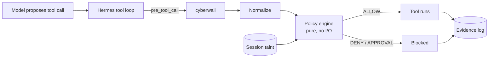

<p align="center">
  
</p>

<p align="center">
  <b>Deterministic policy evaluation for AI agent tool requests.</b><br>
  Local-first. Default deny. Evidence that can be verified offline.
</p>

<p align="center">
  <a href="https://github.com/omermindivanli/cyberwall/actions"></a>
  
  
  
  
</p>

> [!WARNING]
> **Early development — not a production security boundary.**
> The Hermes adapter depends on a proposed upstream hook that is not yet merged.
> Do not treat this package as enforcement until the contract is verified.
> See [`docs/hermes-contract.md`](docs/hermes-contract.md).

---

## The problem

Agents propose high-impact tool actions.
Cyberwall evaluates the final arguments against a deterministic local policy and records redacted, hash-chained evidence.
The evaluator is a pure function. It does not import the runtime.

## What ships today

| | Capability | Meaning |
|---|---|---|
| 🛡️ | **Policy evaluator** | `cyberwall eval` — one request against a policy. Default deny. |
| 🧹 | **Policy lint** | Surfaces overly broad allows and selector conflicts. |
| 🧾 | **Evidence store** | SQLite WAL + hash chain + unkeyed fingerprints + verify/report. |
| 🧰 | **Schema** | Strict JSON Schema; generated copy in `schemas/`. |
| 🔌 | **Hermes adapter** | Experimental. Requires pending upstream hook. |

Session taint, drift monitoring, human approval UX, and the attack lab are not implemented.

## Quick start

```bash
git clone https://github.com/omermindivanli/cyberwall.git
cd cyberwall
make setup
make check
```

Commands currently available:

```bash
cyberwall schema
cyberwall policy lint POLICY.yml
cyberwall eval --policy POLICY.yml --tool TOOL --args '{"key":"value"}'
cyberwall evidence verify --help
cyberwall report --help
```

## A policy you can read in one sitting

```yaml
version: 1
mode: enforce          # audit | enforce
default: deny

rules:
  - id: read-workspace
    effect: allow
    tool: read_file
    paths: ["/workspace/**"]
```

Unknown fields are rejected. Evaluation order is deterministic.
Full format and current limits: [`docs/ARCHITECTURE.md`](docs/ARCHITECTURE.md).

## How it works (intended architecture)



`decide(request, policy, session_state) → decision`
The diagram describes the target system, not the current integration surface.

## Why not just…

| Approach | Strength | Where cyberwall differs |
|---|---|---|
| Stronger system prompt | Intent | Can be overridden by content. Policy is a separate decision point. |
| LLM safety classifier | Known-bad phrasing | Probabilistic. Cyberwall is deterministic. |
| Built-in dangerous-command approval | Interactive catches | No runtime integration yet. |
| Static skill / MCP scanners | Pre-install inspection | Cyberwall evaluates a concrete request. |
| Hosted guardrails | Managed detection | Metadata may leave the box. Cyberwall stays local. |

## What cyberwall does **not** do

- It is not a sandbox or runtime guard (today).
- It cannot prove a page is "safe".
- Path normalization is lexical only.
- Evidence is tamper-evident, not tamper-proof.
- Evidence hashes are unkeyed (guessable for low-entropy values).
- The Hermes adapter is not production-ready.

Honesty about limits is part of the product.

## Roadmap

- [x] Core + evidence foundation
- [ ] **v0.1** — Hermes guard · drift · flow · attack lab (subject to contract spike)
- [ ] **v0.2** — MCP security broker · SARIF/JSON · approval UX
- [ ] **v0.3** — second agent-framework adapter
- [ ] Later (only if asked) — shared team policy management

Not planned: dashboard before the core is trustworthy, "AI-powered" decisions in the critical path, or a hosted service.

## Contributing

**Every security claim ships with an executable test.**
Found a bypass? Open a PR with a failing test in `tests/adversarial/`.
See [`CONTRIBUTING.md`](CONTRIBUTING.md) and [`SECURITY.md`](SECURITY.md).

## Responsible use

The attack corpus is for testing **agents you own**, using synthetic data, in a local lab.
It contains no malware and no tooling for attacking third-party systems.

## License

Apache-2.0.
Built for [Hermes Agent](https://github.com/NousResearch/hermes-agent).
Not affiliated with or endorsed by Nous Research.
